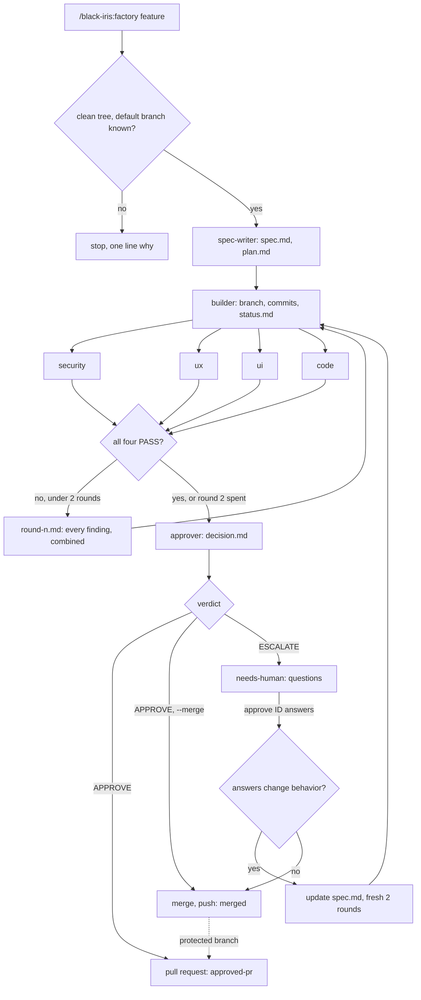

# Factory: one feature from spec to merge, a human on business calls

One feature description goes in. A spec, a branch, four reviews, and a
verdict come out, and the branch merges only when nothing needs a person.
Seven roles, each its own Agent call. Roles hand work over through files in
the job folder, never through each other's reasoning. The pattern follows a
software factory @zazencodes showed for Claude Code.



## When

A clean pass is 7 Agent calls; two rebuild rounds make it 17. It commits
and pushes, so it runs only when typed: `/black-iris:factory <feature>`,
`/black-iris factory <feature>`, or "factory this". "Build X" with no factory
in the ask is Build, not Factory.

Before step 1: the repo is git, the working tree is clean, and the default
branch is known (`git symbolic-ref refs/remotes/origin/HEAD`, else ask). A
dirty tree stops the run with one line saying so.

Input forms:

- `<feature>`: a full run. APPROVE stops at a pull request.
- `<feature> --merge`: APPROVE may also merge into the default branch.
- `approve <ID> [answers]`: resume an escalated job. See the last section.

## The job folder

`~/.BLACK_IRIS_AGENTS/projects/<slug>/factory/<ID>-<feature>/`, with
`<slug>` derived as `memory.md` says. Nothing goes in the repo, so the
factory leaves no files a reviewer has to ignore.

| File | Written by | Holds |
|---|---|---|
| `spec.md` | spec-writer | what to build, how to check it, what is a business call |
| `plan.md` | spec-writer | numbered steps, each naming its files |
| `reviews/<role>.md` | each reviewer | verdict and findings, rewritten per round |
| `reviews/round-<n>.md` | orchestrator | every finding of round n, combined |
| `decision.md` | approver | APPROVE or ESCALATE, reason, questions |
| `status.md` | builder, orchestrator | the dashboard below |

`<ID>` is three digits, one more than the highest job folder there, `001`
first. `<feature>` is the description in lowercase hyphenated words, five at
most.

## Roles and models

| Role | Tier | Reads | Writes |
|---|---|---|---|
| spec-writer | strongest | request, repo | `spec.md`, `plan.md` |
| builder | strongest | spec, plan, reviews | branch, commits, `status.md` |
| reviewer-security | strongest | spec, diff | `reviews/security.md` |
| reviewer-ux | fast | spec, diff | `reviews/ux.md` |
| reviewer-ui | fast | spec, diff | `reviews/ui.md` |
| reviewer-code | fast | spec, diff, test run | `reviews/code.md` |
| approver | strongest | spec, diff, reviews, status | `decision.md` |

Strongest is the most capable model the harness offers, fast is its quicker
tier; in Claude Code the Agent tool's `model` takes `opus` or `sonnet`. Never
write a dated model slug from memory. A harness with one tier uses it for
every role.

Each role prompt holds the job folder path, the repo path, that role's
section below, and one line: "Apply the black-iris Cut list to every file
and commit you write." The orchestrator pastes nothing from one role into
another except combined findings into the builder.

## 1. spec-writer

Reads the repo's `AGENTS.md` or `CLAUDE.md` and the files the feature
touches. Writes `spec.md`:

1. **Title** and **Context**: why the feature exists, in the user's terms.
2. **User stories**, one per role the feature affects.
3. **Acceptance criteria**: a checkbox each, with a `CHECK:` command and an
   `EXPECT:` token as `gates.md` defines them. A criterion no command can
   check says `manual:` and how a person verifies it.
4. **Out of scope**: what the builder must not touch.
5. **Technical notes**: files likely to change, and the risks.
6. **Business decisions**: each open question with its options. The spec
   names them and never answers them.

Then `plan.md`: numbered steps, each naming the files it changes. A fact the
request and the repo do not support is a business decision, never a guess.

## 2. builder

1. Branch `factory/<ID>-<feature>` from the default branch.
2. Implement per `spec.md` and `plan.md`, under the Build rules in
   `SKILL.md`. Add tests when the repo has tests.
3. Run every `CHECK:` before the commit. A failing check is not committed
   as done.
4. Commit per `ship.md`, `feat(<scope>): <subject>`, no AI attribution.
5. Push the branch only. Never the default branch, never with force.
6. Write `status.md`: commits, files changed, each `CHECK:` with its result.

On a rebuild, read `reviews/round-<n>.md` and fix every blocking and fix-now
finding in one round. In `status.md`, name the finding each commit answers.
A finding the builder disputes stays unfixed, with the reason written down,
and the approver sees it.

## 3. Four reviewers, in parallel

Send all four Agent calls in one message. Each reads `spec.md` and
`git diff <default>...factory/<ID>-<feature>`, runs any command it needs,
and edits no code. Severity, ranking, and the five-finding cap follow
`review.md`. Each writes:

```
Verdict: PASS | NEEDS_CHANGES | FAIL
Findings:
- [blocking] src/routes/files.ts:31  joins the request path unchecked;
  ../ reaches .git. Resolve, then reject paths outside the root.
```

FAIL means the approach cannot meet the spec. NEEDS_CHANGES means fixable
blocking or fix-now findings. PASS may carry follow-ups. A reviewer whose
area the diff never touches, such as UI on a backend change, writes
`Verdict: PASS` and `n/a: <why>`.

- **security**: committed secrets, tokens, or `.env`; path traversal, and
  served paths that expose `.git` or dependency folders; signed URLs and
  tokens with no expiry; an authorization check on every new route and on
  gated content; public storage buckets; input validation at each trust
  boundary; any new dependency and where it comes from.
- **ux**: walks each acceptance criterion and story as every user role the
  spec names, such as logged out, ordinary, and admin; error, empty, and
  loading states; navigation in and out of the feature.
- **ui**: matches the repo's existing components and design tokens; layout
  at phone and desktop widths; consistent states and icons; labels, alt
  text, contrast, and keyboard focus.
- **code**: the repo's conventions; runs the test suite and every `CHECK:`
  and pastes command and result; dead code and debug output; error
  handling; changed files against `plan.md`.

## 4. The review gate

Wait for all four files. A missing file or a file with no `Verdict:` line is
a failed reviewer: rerun that one. Never move on with a verdict pending.

All four PASS: go to the approver. Any NEEDS_CHANGES or FAIL: write
`reviews/round-<n>.md` with every finding from all four, blocking first, and
send it to the builder in one call. Then rerun all four reviewers, since a
fix in one area can break another.

At most 2 rebuild rounds. Still failing after round 2, the approver runs with
the open findings in view and returns ESCALATE.

## 5. approver

A fresh Agent call, never the builder's. Reads `spec.md`, every review, the
diff, and `status.md`, and writes `decision.md`:

```
Verdict: APPROVE | ESCALATE
Reason: two to four lines
Questions for the human:
1. Should attachments stay behind the paywall? Options: yes, no, per course.
```

APPROVE needs all four PASS, every `CHECK:` passing in the code review, no
open business decision in the spec, and no risk the spec did not name.
Anything else is ESCALATE. ESCALATE is the safe outcome, not a failure. The
approver writes the verdict; the orchestrator acts on it.

## 6. The final gate

- **APPROVE**: push the branch, open a pull request (`gh pr create`) with the
  body built from the spec and the decision per `ship.md`. Status
  `approved-pr`.
- **APPROVE with `--merge`**: merge the way the repo merges, then push.
  Status `merged`. A protected default branch rejects the push: open the pull
  request instead and say so. Never bypass a branch rule, skip a hook, or
  force-push.
- **ESCALATE**: status `needs-human`. Show the questions from `decision.md`
  and stop.

The factory runs no deploy command. Whatever the repo deploys on a merge to
its default branch is the deploy.

## approve <ID> [answers]

1. Read `decision.md`. Append the answers under `Answers:`, dated.
   A job escalated with blocking findings still open lists them first,
   and merges only when the answers say to merge despite them.
2. An answer that changes behavior updates `spec.md`, then the builder and
   all four reviewers run again, with a fresh budget of 2 rounds.
3. Otherwise merge as in step 6. The typed `approve` stands in for
   `--merge`. Status `merged`.

Job folders stay after a merge. They record why the code looks the way it
does.

## status.md

The dashboard. The orchestrator rewrites `Status:` at every step.

```
# 004 public lesson pages
Status: specced | building | reviewing round 1 | needs-human | approved-pr | merged
Branch: factory/004-public-lesson-pages
Commits: a1b2c3d feat(lessons): serve lesson text without a subscription
Checks: 3 of 3 pass
Reviews: security PASS, ux NEEDS_CHANGES (1 blocking), ui PASS n/a, code PASS
Decision: ESCALATE, see decision.md
Next: /black-iris:factory approve 004 <answers>
```

A web dashboard waits until someone needs to see jobs without a terminal.

## The reply

Line one: the verdict and the next action, such as "ESCALATE: 2 business
questions. Answer with `/black-iris:factory approve 004 ...`". Then the
reviews line, the questions, and the path to `status.md`.
